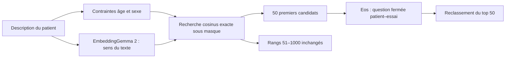
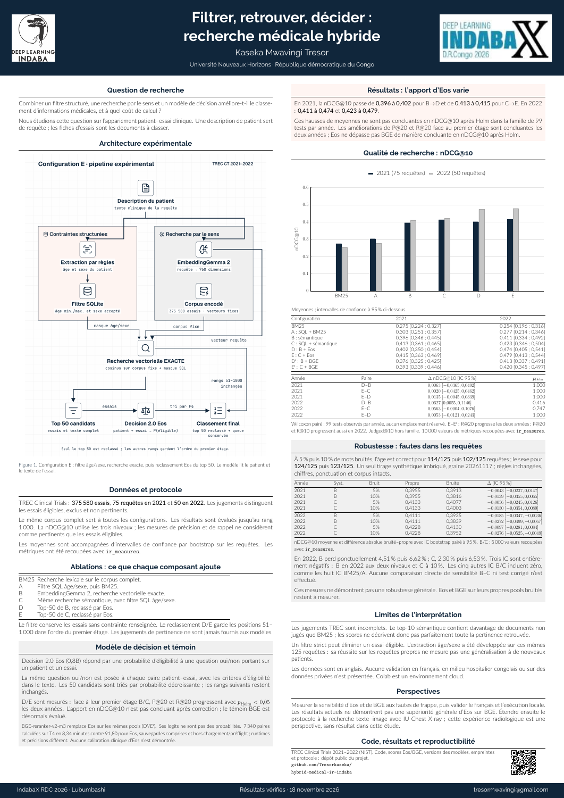

<div align="center">

# Filtrer, retrouver, décider
### Architecture hybride pour la recherche d’informations médicales

**SQL · EmbeddingGemma 2 · Eos · Témoin BGE**  
Kaseka Mwavingi Tresor · Université Nouveaux Horizons · RDC  
Version de recherche pour IndabaX RDC 2026

[Papier FR](paper/main_fr.pdf) · [Paper EN](paper/main.pdf) · [Poster](poster/main.pdf) · [Slides](presentation/presentation.pdf) · [Reproduire](docs/public/reproduire.md)

</div>

## La question

Pour un même patient, comment retrouver les essais cliniques pertinents dans une grande collection ? Nous comparons des contraintes exactes d’âge et de sexe, la recherche par les mots, la recherche par le sens et un second examen des candidats par un petit modèle de décision.

**Terrain mesuré : 125 descriptions de patients, 375 580 essais publics en anglais, TREC Clinical Trials 2021–2022.** Les modèles sont préentraînés et figés : aucun entraînement supplémentaire n’a été effectué.

> Les gains observés concernent certaines mesures de précision et de rappel. Ils ne démontrent ni une supériorité générale d’Eos, ni un bénéfice clinique. L’usage en français et sur un GPU local de type RTX 3050 reste à évaluer.

## Le parcours expérimental



Ce schéma décrit la configuration **E**. Les configurations **D′/E′** remplacent Eos par BGE sur les mêmes candidats. Il n’y a pas de fusion BM25–vecteurs ni d’index approximatif dans l’expérience mesurée.

## Huit configurations pour isoler les contributions

| Configuration | Première recherche | Second examen du top 50 |
|---|---|---|
| BM25 | Mots-clés, corpus complet | — |
| A | Filtre âge/sexe puis BM25 | — |
| B | Sens du texte, corpus complet | — |
| C | Sens du texte sous filtre âge/sexe | — |
| D / E | B / C | Eos 0,8B |
| D′ / E′ | B / C | BGE-reranker-v2-m3 |

## Résultats vérifiés

**nDCG@10** mesure la qualité de l’ordre des dix premiers résultats, en tenant compte des trois niveaux de jugement TREC. Plus élevé signifie meilleur sur cette mesure ; une moyenne plus élevée ne suffit pas à établir un écart statistiquement concluant.

| Année | BM25 | A | B | C | D · Eos | E · Eos | D′ · BGE | E′ · BGE |
|---|---:|---:|---:|---:|---:|---:|---:|---:|
| 2021 | 0,2747 | 0,3033 | 0,3955 | 0,4133 | 0,4018 | 0,4153 | 0,3758 | 0,3928 |
| 2022 | 0,2538 | 0,2775 | 0,4111 | 0,4228 | 0,4738 | 0,4791 | 0,4131 | 0,4204 |

- **D−B et E−C :** P@20 et R@20 progressent de façon concluante les deux années après correction de Holm ; les écarts de nDCG@10 restent non concluants.
- **Eos face à BGE :** moyennes nDCG supérieures, mais aucun écart D−D′ ou E−E′ concluant sur cette métrique. E−E′ améliore R@20 les deux années.
- **Coût observé pour 7 340 paires :** Eos 91,80 minutes ; BGE 8,34 minutes. Sauvegardes comprises, hors chargement et préflight. Précisions et runtimes différents : ces durées ne sont pas une latence de consultation ni une comparaison pure de l’efficacité des modèles.

[Résultats et interprétation](docs/public/resultats.md) · [Rapport canonique JSON](results/exp1_decision_eos_bge.json) · [Méthode](docs/public/methode.md)

## Consulter, vérifier, reproduire

| Votre objectif | Point d’entrée |
|---|---|
| Comprendre le projet | [Guide documentaire](docs/public/README.md) |
| Lire le travail | [Papier français](paper/main_fr.pdf), [anglais](paper/main.pdf) — manuscrits de travail |
| Présenter | [Poster](poster/main.pdf), [slides PDF](presentation/presentation.pdf), [notes orales](presentation/NOTES.md) |
| Vérifier les fichiers publiés | `python3 scripts/verify_public_release.py` |
| Tester le code | Installation ci-dessous, puis `python -m pytest -q` |
| Recalculer les mesures | [Reproduction sans nouvelle inférence](docs/public/reproduire.md) |
| Comprendre les empreintes | [Artefacts et provenance](docs/public/artefacts.md) |

```bash
git clone https://github.com/Tresorkaseka/hybrid-medical-ir-indaba.git
cd hybrid-medical-ir-indaba
python3 -m venv .venv
source .venv/bin/activate
python -m pip install -e '.[dev]'
python -m pytest -q
python scripts/verify_public_release.py
```

Python ≥3.11. `requirements-lock.txt` conserve l’environnement CPU observé ; les versions GPU BGE sont dans `results/bge-control-raw/requirements.txt`. Cette installation de base ne télécharge ni corpus ni poids de modèles. Les versions verrouillées ne garantissent pas la disponibilité de roues binaires sur toutes les plateformes.

Pour présenter les slides avec animations, servir le dossier localement :

```bash
python3 -m http.server 8790 --bind 127.0.0.1 --directory presentation
```

Ouvrir <http://127.0.0.1:8790/>. Les dépendances Reveal.js sont incluses ; le PDF est la version statique de secours.

## Ce que cette version ne démontre pas

L’étude est rétrospective, sur des jugements TREC incomplets. Les règles démographiques ont été développées sur les mêmes 125 requêtes. Le test de fautes comporte un seul tirage synthétique imbriqué à 5 % et 10 %, pour BM25/A/B/C seulement. Il n’y a ni calibration clinique, ni évaluation hospitalière, ni mesure en français. IU Chest X-ray, la recherche texte–image et l’exécution locale sur RTX 3050 restent des perspectives.

Les PDF sont des manuscrits de recherche en cours de finalisation. Le protocole, les résultats détaillés et les limites sont documentés dans ce dépôt.

## English summary

Research artifact for hybrid medical information retrieval on TREC Clinical Trials 2021–2022. Eight configurations compare lexical retrieval, demographic constraints, exact semantic retrieval, Eos decision scoring and a BGE reranking control on identical candidate pools. Targeted precision/recall gains do not establish general nDCG superiority or clinical utility. See the [English manuscript](paper/main.pdf) and [artifact guide](docs/public/artefacts.md).

<details>
<summary>Aperçu du poster</summary>

[](poster/main.pdf)

</details>

## Citer et réutiliser

Utiliser [CITATION.cff](CITATION.cff) pour citer cette version du dépôt. Aucun DOI n’a été attribué. Les sources de données, modèles, fontes et outils conservent leurs conditions propres : [droits et composants tiers](docs/public/droits.md). Aucune licence générale de réutilisation n’est attribuée au code original dans cette première publication ; l’accès public ne remplace pas une licence.
